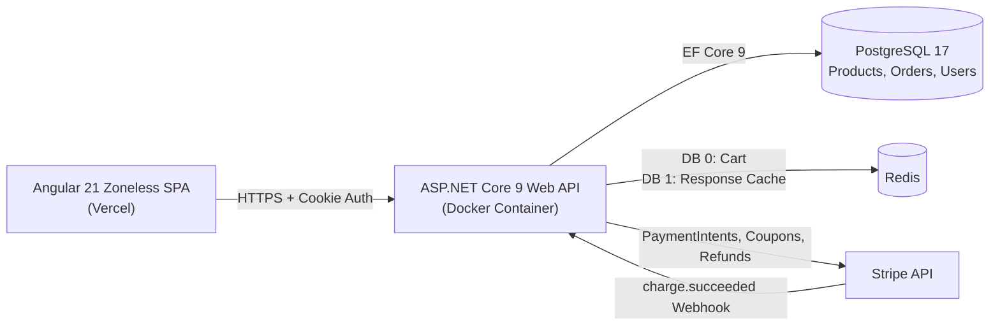

<div align="center">

# ⛷️ SkiShop — Full-Stack E-Commerce Platform

A modern, full-stack winter sports e-commerce application built with **ASP.NET Core 9**, **Angular 21 (Zoneless)**, **PostgreSQL**, **Redis**, and **Stripe**.

[](https://ski-shop-e-commerce-e8td.vercel.app/)
[](https://dotnet.microsoft.com/)
[](https://angular.dev/)
[](https://www.postgresql.org/)
[](https://redis.io/)
[](https://stripe.com/)
[](https://tailwindcss.com/)
[](https://www.docker.com/)

### 🌐 [Open Live Storefront →](https://ski-shop-e-commerce-e8td.vercel.app/)

</div>

---

## 📖 Overview

**SkiShop** is an end-to-end e-commerce platform designed with clean layered architecture on the backend and a reactive, signal-driven SPA on the frontend. It supports product browsing with advanced filtering, persistent Redis shopping carts, promotional coupon codes, secure Stripe checkout with webhook order fulfillment, role-based access control, an Admin dashboard with Stripe refunds, and Redis response caching.

---

## 🏗️ System Architecture



### Backend Layered Architecture (`SkiShop/`)
- **`SkiShop.Core`**: Domain entities (`Product`, `AppUser`, `Address`, `AppShoppingCart`, `AppCoupon`, `Order`, `OrderItem`, `DeliveryMethod`), repository/service interfaces, specification abstractions, and currency calculation helpers.
- **`SkiShop.Infrastructure`**: EF Core `StoreContext` (`IdentityDbContext<AppUser>`), PostgreSQL migrations, automatic data & role seeding (`StoreContextSeed`), Repository & Unit of Work implementations, and `CartService`, `ResponseCacheService`, `PaymentService`, `CouponService`, `OrderService`.
- **`SkiShop.API`**: RESTful controllers, DTOs & mapping extensions, global `ExceptionMiddleware`, and custom action filters (`CacheAttribute`, `InvalidateCache`).

---

## ✨ Key Features

### 🛍️ Storefront & Shopping Experience
- **Catalog Filtering, Search & Sorting**: Powered by the **Specification Pattern** (`ProductSpecification`, `BrandListSpecification`, `TypeListSpecification`) with server-side pagination (`Pagination<T>`).
- **Persistent Cart**: Stored in **Redis** (`DB 0`, 30-day expiration) with real-time state updates using Angular Signals and `httpResource`.
- **Image Optimization**: Uses Angular `NgOptimizedImage` with `priority` loading and base64 blur placeholders for fast rendering and zero layout shift.

### 💳 Checkout, Coupons & Stripe Integration
- **Promo Codes & Discounts**: Validates Stripe promotion codes via `CouponsController` & `CouponService`, supporting both fixed-amount (`AmountOff`) and percentage (`PercentOff`) discounts.
- **Stripe PaymentIntents**: Creates and updates payment intents dynamically as cart items, delivery methods, or coupons change.
- **Webhook Fulfillment**: Verifies `Stripe-Signature` on `POST /api/payments/webhook` (`charge.succeeded`) to reliably create orders and clear the cart.

### 🔐 Security & Role-Based Access Control (RBAC)
- **Authentication**: ASP.NET Core Identity API endpoints using HTTP-only cookies (`SameSite=None`, `SecurePolicy=Always`) and Angular's `withCredentials` interceptor (`authInterceptor`).
- **Authorization & Guards**: Separate `Customer` and `Admin` roles enforced on both backend (`[Authorize(Roles = "Admin")]`) and frontend (`authGuard`, `adminGuard`, `emptyCartGuard`, and `*appIsAdmin` structural directive).

### 🛡️ Admin Portal
- **Order Management**: Dedicated `/admin` dashboard with status filtering (`PaymentReceived`, `PaymentMismatch`, `Refunded`, etc.), pagination, and detailed order inspection.
- **Stripe Refunds**: Admins can issue full refunds directly from the dashboard or order details page with confirmation dialogs (`DialogService` + `ConfirmationDialogComponent`).
- **Product CRUD**: Protected product creation, update, and deletion endpoints with automatic cache invalidation.

### ⚡ Performance & Caching
- **Zoneless Change Detection & Signal Forms**: Angular 21 runs without `zone.js`, using Signals, `httpResource`, and `@angular/forms/signals` for fine-grained reactivity and smaller bundles.
- **Redis Response Caching**: `[Cache(ttl)]` action filter caches GET responses in Redis (`DB 1`) keyed by request path and sorted query parameters.
- **Automatic Cache Invalidation**: `[InvalidateCache("api/products|")]` automatically clears stale cached product responses after successful admin create/update/delete operations.

---

## 🛠️ Tech Stack

| Layer | Technologies |
| :--- | :--- |
| **Backend** | C#, .NET 9, ASP.NET Core Web API, Entity Framework Core 9, ASP.NET Core Identity, Swashbuckle (Swagger) |
| **Frontend** | Angular 21 (Zoneless), TypeScript 5.9, Angular Material 21, Tailwind CSS 3.4, RxJS, Angular Signals, `httpResource` & Signal Forms |
| **Databases & Caching** | PostgreSQL 17 (`Npgsql`), Redis (`StackExchange.Redis`) |
| **Payments** | Stripe (`Stripe.net` + `@stripe/stripe-js` + Stripe Webhooks) |
| **Deployment & DevOps** | Vercel (Frontend SPA), Docker & Docker Compose, Multi-stage Dockerfile (Backend) |

---

## 📁 Project Structure

```text
Ski-Shop-E-Commerce-/
├── README.md
└── SkiShop/
    ├── SkiShop.sln
    ├── Dockerfile
    ├── docker-compose.yml
    ├── SkiShop.Core/
    │   ├── Entities/                 # Product, AppUser, AppShoppingCart, AppCoupon, OrderAggregate
    │   ├── Extensions/               # MoneyExtensions
    │   ├── Interfaces/               # IGenericRepository, IUnitOfWork, ISpecification, Services
    │   └── Specifications/           # ProductSpecification, OrderSpecification, SpecParams
    ├── SkiShop.Infrastructure/
    │   ├── Config/                   # EF Core entity & role configurations
    │   ├── Data/                     # StoreContext, StoreContextSeed, SeedData/, UnitOfWork
    │   ├── Migrations/               # EF Core PostgreSQL migrations
    │   └── Services/                 # CartService, ResponseCacheService, OrderService, PaymentService, CouponService
    ├── SkiShop.API/
    │   ├── Controller/               # Products, Cart, Account, Orders, Payments, Coupons, Admin, Buggy
    │   ├── DTOs/                     # Request & response DTOs
    │   ├── Extensions/               # ClaimsPrincipal & Mapping extensions
    │   ├── Middleware/               # ExceptionMiddleware
    │   ├── RequestHelpers/           # Pagination, CacheAttribute, InvalidateCache
    │   └── Program.cs
    └── client/
        ├── vercel.json               # SPA rewrite rules for Vercel
        └── src/app/
            ├── core/                 # Guards, Interceptors, Resolvers, Services
            ├── features/             # Home, Shop, ProductDetails, Cart, Checkout, Orders, Account, Admin
            ├── layout/               # Header navigation
            └── shared/               # Directives (*appIsAdmin), Dialogs, Models, Pipes
```

---

## 🔌 API Endpoints Overview

| Area | Endpoint | Access | Description |
| :--- | :--- | :--- | :--- |
| **Products** | `GET /api/products` | Public (Cached) | Paginated, filtered, and sorted product catalog |
| **Products** | `GET /api/products/{id}` | Public | Single product details |
| **Products** | `GET /api/products/brands`, `/types` | Public (Cached) | Distinct product brands and types |
| **Products** | `POST`, `PUT /{id}`, `DELETE /{id}` | Admin | Create, update, or delete products (invalidates cache) |
| **Cart** | `GET`, `POST`, `DELETE /api/cart` | Public | Retrieve, update, or delete Redis shopping cart |
| **Account** | `POST /api/login`, `POST /api/account/register` | Public | Cookie-based login & user registration |
| **Account** | `GET /api/account/user-info`, `POST /api/account/address` | Authenticated | Current user profile, roles & saved shipping address |
| **Coupons** | `GET /api/coupons/{code}` | Public | Validate Stripe promotion code |
| **Payments** | `POST /api/payments/{cartId}` | Authenticated | Create or update Stripe PaymentIntent |
| **Payments** | `GET /api/payments/delivery-methods` | Public | List available shipping methods |
| **Payments** | `POST /api/payments/webhook` | Stripe Webhook | Process `charge.succeeded` and create order |
| **Orders** | `POST /api/orders`, `GET /api/orders`, `GET /api/orders/{id}` | Authenticated | Create and view customer orders |
| **Admin** | `GET /api/admin/orders`, `GET /api/admin/orders/{id}` | Admin | Paginated & filterable list of all customer orders |
| **Admin** | `POST /api/admin/orders/refund/{id}` | Admin | Issue Stripe refund and mark order as `Refunded` |

---

## 🚀 Getting Started (Local Development)

### Prerequisites
- [.NET 9 SDK](https://dotnet.microsoft.com/download/dotnet/9.0)
- [Node.js (v20.19+ / v22.12+ / v24+)](https://nodejs.org/) & npm
- [Docker Desktop](https://www.docker.com/products/docker-desktop/) (for PostgreSQL 17 & Redis)
- A [Stripe](https://stripe.com/) account (test API keys for checkout/coupons/refunds)

### 1. Clone the Repository
```bash
git clone https://github.com/Gehad555/Ski-Shop-E-Commerce-.git
cd Ski-Shop-E-Commerce-/SkiShop
```

### 2. Start PostgreSQL & Redis with Docker
```bash
docker compose up -d
```
This spins up:
- **PostgreSQL 17** on `localhost:5432` (database: `skinet`)
- **Redis** on `localhost:6379`

### 3. Configure Stripe Secrets
Set your Stripe test keys in `SkiShop.API` using User Secrets (recommended) or `appsettings.Development.json`:
```bash
dotnet user-secrets --project SkiShop.API set "StripeSettings:SecretKey" "sk_test_your_secret_key"
dotnet user-secrets --project SkiShop.API set "StripeSettings:WhSecret" "whsec_your_webhook_secret"
```

### 4. Run the Backend API
```bash
dotnet run --project SkiShop.API
```
- EF Core migrations and database seeding (`StoreContextSeed`) run automatically at startup.
- Swagger UI is available in development at `https://localhost:7076/swagger` (or `http://localhost:5088/swagger`).

> **Local Dev Seeded Admin Account** (`StoreContextSeed.cs`):
> - **Email:** `admin@test.com`
> - **Password:** `Pa$$w0rd`

### 5. Run the Angular Frontend
```bash
cd client
npm install
npm start
```
> Note: Ensure `client/src/environments/environment.development.ts` points `apiUrl` to your local API URL if testing against the local backend instead of the deployed container.

---

## 🐳 Docker Build (Backend)

To build and run the API container directly:
```bash
cd SkiShop
docker build -t skishop-api .
docker run -p 8080:8080 skishop-api
```

---

<div align="center">
  Built with ❤️ by <a href="https://github.com/Gehad555">Gehad555</a>
</div>
